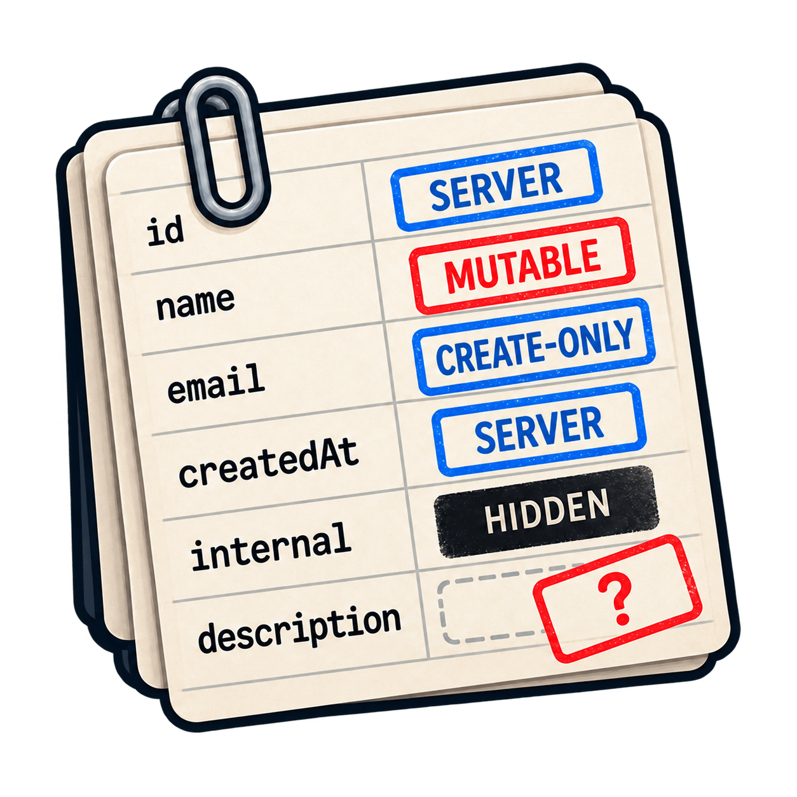

# @b2m9/zod-views

<p align="center">
  
</p>

Define an entity once as a Zod object, give every field a role, and get the
three schemas an API needs: a strict `create` input, a strict `update` input
that is safe for PATCH, and a `read` schema that strips hidden fields.

## Why not plain Zod

A hand-written PATCH schema silently resets stored data:

```ts
import { z } from "zod";

const UserCore = z.object({
  id: z.uuid(),
  email: z.email(),
  passwordHash: z.string(),
  name: z.string().min(1),
  plan: z.enum(["free", "pro"]).default("free"),
});

const stored = {
  id: "3f975ea5-df7b-4eb0-8585-ef6bf73de57d",
  email: "ada@example.com",
  passwordHash: "$argon2id$...",
  name: "Ada",
  plan: "pro",
};
const body = { name: "Ada Lovelace" };

const HandPatch = UserCore.pick({ name: true, plan: true }).partial();
HandPatch.parse(body); // { name: 'Ada Lovelace', plan: 'free' }
({ ...stored, ...HandPatch.parse(body) }).plan; // free
```

The client asked to rename a pro user. The merge also moved them to the free
plan. Zod runs every field schema with `undefined` for a missing key, so
`.default()` fires through `.partial()`, `.optional()`, `.exactOptional()`, and
4.5's `.exactPartial()`. This is intended Zod behavior. It is correct for
create input and wrong for a patch.

`defineViews` derives an update view in which an absent key never runs its
field:

```ts
import { defineViews } from "@b2m9/zod-views";

const User = defineViews(UserCore, {
  id: "server",
  email: "create-only",
  passwordHash: "server hidden",
  name: "mutable",
  plan: "mutable",
});

User.update.parse(body); // { name: 'Ada Lovelace' }
({ ...stored, ...User.update.parse(body) }).plan; // pro
```

The table is exhaustive. Add a field to `UserCore` months later and the same
call stops compiling until someone decides whether clients may write the field
and whether reads may return it:

```ts
const UserCore = z.object({
  // id, email, passwordHash, name, and plan as above
  referralCode: z.string(),
});

defineViews(UserCore, {
  id: "server",
  email: "create-only",
  passwordHash: "server hidden",
  name: "mutable",
  plan: "mutable",
  // error TS2345: Property 'referralCode' is missing in type '{ id: "server"; ... }'
});
```

JavaScript callers get the same check when the views are defined:
`Field "referralCode" is missing from the table; classify every core field.`
Stale and misspelled entries fail the same way.

## What you get

| Role          | `create` | `update`           | `read` |
| ------------- | -------- | ------------------ | ------ |
| `mutable`     | yes      | optional, shielded | yes    |
| `create-only` | yes      | no                 | yes    |
| `server`      | no       | no                 | yes    |
| `unmapped`    | no       | no                 | no     |

Append ` hidden` to `mutable`, `create-only`, or `server` to remove the field
from `read`. Visibility never changes writability. `unmapped` exists only with
a [bound row](#binding-to-a-stored-row) and classifies a column without a core
field.

- `create` and `update` reject unknown keys. `read` strips hidden and unknown
  keys and validates the rest, so invalid stored data throws.
- `create` keeps each core field as written, including its default. `update`
  never runs a field for an absent key.
- `z.input` and `z.output` of each view equal the schema you would write by
  hand, including transforms and defaults. A type test enforces this for every
  release.
- Each view is a plain, unrefined `ZodObject`. `.extend`, `.omit`, `.refine`,
  `z.toJSONSchema`, and `@hono/zod-openapi` work on it as on any other object.

```ts
User.create.parse({ email: "ada@example.com", name: "Ada" });
// { email: 'ada@example.com', name: 'Ada', plan: 'free' }

User.create.safeParse(stored).error?.issues[0]?.code;
// unrecognized_keys

User.read.parse(stored);
// { id: '3f975ea5-df7b-4eb0-8585-ef6bf73de57d', email: 'ada@example.com', name: 'Ada', plan: 'pro' }

type UserUpdate = z.infer<typeof User.update>;
// { name?: string | undefined; plan?: "free" | "pro" | undefined }
```

Because write views are strict, echoing a fetched entity into one fails. Send
only writable fields.

## Is it for you

Use it when one entity is created, patched, and read through an API and its
fields form a plain Zod object. Use plain Zod for unions, commands, events,
search parameters, and one-off request bodies.

You can write the three views by hand; the type tests compare each view against
exactly that. This package makes the classification exhaustive and the patch
shield impossible to forget. drizzle-zod derives insert, update, and select
schemas from Drizzle tables, and Prisma generators derive them from a Prisma
schema. zod-views starts from any Zod object, such as an API contract that
differs from the table, assigns each field an API role, and can check that
object against the table's row type.

## Install

```sh
pnpm add @b2m9/zod-views "zod@^4.4.3"
```

ESM only, Node 22+. Zod is the only peer dependency, and there are no runtime
dependencies. CI tests Zod 4.4.3 and the newest 4.x.

## Update semantics

Each mutable field becomes `z.optional(z.nonoptional(field))`.

```ts
User.update.parse({}); // {}
User.update.parse({ plan: undefined }); // { plan: undefined }

const issues = (input: unknown) =>
  User.update.safeParse(input).error?.issues.map(({ code, path }) => ({ code, path }));
issues({ name: "" }); // [ { code: 'too_small', path: [ 'name' ] } ]
issues({ plan: "gold" }); // [ { code: 'invalid_value', path: [ 'plan' ] } ]
issues({ name: 42 }); // [ { code: 'invalid_type', path: [ 'name' ] } ]
```

- An absent key stays absent. An empty patch is valid.
- A provided value validates through the original field, which reports its own
  issue. Message wording is not promised.
- Explicit `undefined` skips the field and stays an own key. JSON bodies cannot
  carry it, but in-process callers can, and a spread merge then clobbers the
  stored value. Drop those keys before merging:

```ts
const patch = User.update.parse({ plan: undefined });
({ ...stored, ...patch }).plan; // undefined

const defined = Object.fromEntries(
  Object.entries(patch).filter(([, value]) => value !== undefined),
);
({ ...stored, ...defined }).plan; // pro
```

## Composition

Policy beyond the roles belongs in ordinary Zod on the view that owns it:

```ts
const SignupInput = User.create.extend({ password: z.string().min(12) });
const PublicUser = User.read.omit({ email: true });
const NonEmptyUpdate = User.update.refine((p) => Object.values(p).some((v) => v !== undefined));

PublicUser.parse(stored); // { id: '3f975ea5-df7b-4eb0-8585-ef6bf73de57d', name: 'Ada', plan: 'pro' }
NonEmptyUpdate.safeParse({}).success; // false
```

Nest one entity in another the same way: swap the field per view. The nested
update is shielded like any other field, so an absent address stays untouched
and a present one is a partial patch.

```ts
const Address = defineViews(AddressCore, {
  street: "mutable",
  country: "mutable",
  geohash: "server hidden",
});

const CreateUnit = Unit.create.extend({ address: Address.create });
const UpdateUnit = Unit.update.extend({ address: z.optional(z.nonoptional(Address.update)) });
const ReadUnit = Unit.read.extend({ address: Address.read });

UpdateUnit.parse({ address: { country: "AT" } }); // { address: { country: 'AT' } }
```

A nested patch needs a per-level merge when persisting; one spread no longer
suffices.

## Binding to a stored row

Pass `storedAs<Row>()` as a third argument to tie the table to a stored row
type, such as Drizzle's `typeof payment.$inferSelect`. Row must be a finite,
non-union object type with string keys and no index signatures, whether an ORM
infers it or you write it; zod-views never reads a table definition.

```ts
import { defineViews, storedAs } from "@b2m9/zod-views";

type PaymentRow = {
  id: string;
  amount: string; // a numeric column
  note: string | null;
  railReference: string | null;
};

const PaymentCore = z.object({
  id: z.uuid(),
  amount: z.codec(z.number(), z.string(), {
    decode: (wire) => String(wire),
    encode: (stored) => Number(stored),
  }),
  note: z.string().nullable(),
});

const Payment = defineViews(
  PaymentCore,
  { id: "server", amount: "create-only", note: "mutable", railReference: "unmapped" },
  storedAs<PaymentRow>(),
);
```

The views are the ones the table derives without a row. The call stops
compiling when:

1. Row is `any`, `never`, a union, or has an index signature.
2. A core field is not a row column.
3. A row column has no entry. `unmapped` keeps it out of every view.
4. An entry names neither a core field nor a row column.
5. A core field's output differs from its column in type or optionality.

Outputs are compared because writes store them. The comparison needs
`strictNullChecks`; without it, `z.string()` matches a `string | null` column.
`.optional()` and `.exactOptional()` fields fail against required columns; use
`.nullable()` for a nullable column, `.default()` when absent input still
stores a value, or `.nullable().default(null)` for a nullable column that
create may omit. A matching optional Row property is accepted, and telling
`p?: string` from `p?: string | undefined` needs `exactOptionalPropertyTypes`.
An enum fails against a `text` column until the column is narrowed, for
example with Drizzle's `text({ enum })` or `$type<>()`. An untyped `json()`
column is `unknown`, which only an unknown-output schema such as `z.unknown()`
matches; `$type<>()` narrows the inferred column type so a schema for its
contents can bind, while the Zod schema does the runtime validation. `any` as a
column or output type fails; `any` nested inside a column type, such as
`Record<string, any>`, is not detected.

A codec stores its output, so reads go back through `z.encode`. The decimal
codec above passes the number through unrounded; the database rounds to the
column scale, and `toFixed` would round differently.

```ts
const row = {
  id: "3f975ea5-df7b-4eb0-8585-ef6bf73de57d",
  amount: "12.50",
  note: null,
  railReference: null,
};

Payment.create.parse({ amount: 12.5, note: null }); // { amount: '12.5', note: null }
z.encode(Payment.read, row); // { id: '3f975ea5-df7b-4eb0-8585-ef6bf73de57d', amount: 12.5, note: null }
Payment.read.safeParse(row).success; // false
```

Binding proves that output types agree, not that encoding succeeds or
round-trips: a one-way `.transform()` on a visible field binds when its output
matches its column, but `z.encode` on the read view then throws.

Hoisted tables use `satisfies FieldsFor<typeof PaymentCore, PaymentRow>`.
Insert completeness is not checked. Row types are erased at runtime, so
JavaScript callers get the core checks and the rejection of `unmapped` on core
fields, but any `unmapped` key is accepted, even one that names no column, and
nothing checks that every column is classified.

## JSON Schema and OpenAPI

Each update field renders as the core field's own schema, without `required`:

```ts
z.toJSONSchema(User.update);
// {"$schema":"https://json-schema.org/draft/2020-12/schema","type":"object","properties":{"name":{"type":"string","minLength":1},"plan":{"default":"free","type":"string","enum":["free","pro"]}},"additionalProperties":false}
```

A view converts whenever the core converts with the same options, such as
`io: "input"` for transforms. A core with codecs needs `io: "input"` on every
view, including `read`: the default output side documents the stored types and
throws for `Date`. The `default` annotation stays, although `update` never
applies it. Drop it with an override if your tooling reads it:

```ts
z.toJSONSchema(User.update, {
  override: ({ zodSchema, jsonSchema }) => {
    if (zodSchema instanceof z.ZodOptional && zodSchema.unwrap() instanceof z.ZodNonOptional) {
      delete jsonSchema.default;
    }
  },
}).properties;
// {"name":{"type":"string","minLength":1},"plan":{"type":"string","enum":["free","pro"]}}
```

Views also work as route schemas in `@hono/zod-openapi`:

```ts
import { OpenAPIHono, createRoute } from "@hono/zod-openapi";

const updateMe = createRoute({
  method: "patch",
  path: "/me",
  request: { body: { content: { "application/json": { schema: User.update } } } },
  responses: {
    200: { description: "Updated user", content: { "application/json": { schema: User.read } } },
  },
});

const app = new OpenAPIHono();
app.openapi(updateMe, (c) => c.json(User.read.parse({ ...stored, ...c.req.valid("json") }), 200));
// PATCH /me {"name":"Ada Lovelace"} → { id: '3f975ea5-df7b-4eb0-8585-ef6bf73de57d', email: 'ada@example.com', name: 'Ada Lovelace', plan: 'pro' }
// PATCH /me {"plan":"gold"} → 400
```

## Hoisted tables

Check a separately declared table with `satisfies` and the exported
`FieldsFor` type:

```ts
import { defineViews, type FieldsFor } from "@b2m9/zod-views";

const userFields = {
  id: "server",
  email: "create-only",
  passwordHash: "server hidden",
  name: "mutable",
  plan: "mutable",
} satisfies FieldsFor<typeof UserCore>;
const User = defineViews(UserCore, userFields);
```

`defineViews` rejects an annotation such as `: FieldsFor<typeof UserCore>`,
which widens every role to the full union. `as const` keeps literal roles but
checks the table only at the call.

## Limits

- Roles apply to top-level fields only. A provided nested object is parsed and
  replaced as a whole, so its inner defaults apply. For a mutable
  `settings: z.object({ theme: z.string(), locale: z.string().default("en") })`,
  the patch `{ settings: { theme: "dark" } }` parses to
  `{ settings: { theme: 'dark', locale: 'en' } }`.
- An `.optional()` core field cannot be cleared through `update`; `null` fails
  with `invalid_type` unless the core field is nullable.
- There is no update-only role, such as a version token, and no per-audience
  read view. Use `.extend` and `.omit` on the views.
- The `default` annotation stays in the update view's JSON Schema and OpenAPI
  output. The override above removes it for `z.toJSONSchema`; other generators
  need their own hook. A field registered with an `id` renders as a shared
  `$ref` whose definition keeps its `default`.
- A transform that returns `undefined` for a provided value fails with
  `invalid_type` in `update`.
- The core must be a plain object without refinements or pipes. Refine the
  derived view that owns the policy instead.

## License

MIT © 2026 Bob Massarczyk
